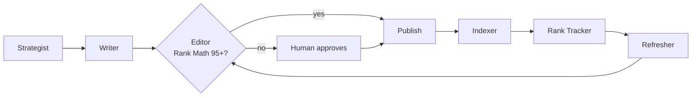

# seo-agent-team

Six small AI agents that keep a WordPress site growing: they pick a keyword people really search, research
sourced facts, write a long article, fix it until it scores 95+ in Rank Math, publish it, get it indexed, track how
it ranks, and rewrite the ones stuck on page two.

Anything that doesn't reach 95 is never published on its own. It waits for a human.

## The problem

Most small business websites go quiet after launch. Nobody has time to research keywords, write 2,500 careful
words, fill in every SEO box, make images, submit the page to search engines and then go back to fix the posts
that almost rank. So the blog has three posts from 2023 and the site gets no search traffic.

AI writing tools help with one step and leave the rest to you. This runs the whole loop, on free model tiers,
with a hard quality gate in the middle.

## The team



| Agent | What it does |
|---|---|
| **Strategist** | Reads Google's search suggestions for your seed topics and, once connected, the Search Console queries your site nearly ranks for. Picks a 2 to 4 word focus keyword with real buying intent that you haven't used before. |
| **Writer** | Searches the web, reads the pages, and keeps a fact only if the exact sentence and every number in it really appear on the source page. Then writes a 2,600 to 2,900 word article from those facts and your own business facts file. It is told never to invent statistics, prices, quotes or client stories. |
| **Editor** | Runs Rank Math's content tests locally (keyword placement and density, length, headings, links, table of contents, images, title rules). Fixes the mechanical rules in code, grows short sections, and asks the model to repair what's left, keeping the best version. Draws the featured image and three graphics, and builds the post with Rank Math's TOC and FAQ blocks. |
| **Indexer** | Sends every new or updated URL to Bing straight away through the Bing Webmaster API (which also feeds IndexNow partners) and resubmits your sitemap to Google Search Console. |
| **Rank Tracker** | Pulls impressions, clicks, average position and top searches for every article from Google and Bing, plus whether Google has indexed each page. |
| **Refresher** | Finds an article that is 3+ weeks old, has 30+ impressions and sits at position 8 to 30, and rewrites it around the searches people actually find it with. The live page is only updated if the rewrite still passes the Editor. |

## The safety gate

An article goes live without you only if all of these are true:

- the local Rank Math check is at or above `SEO_TARGET_SCORE` (95 by default)
- it is long enough and the keyword density is in range
- the Rank Math fields (focus keyword, SEO title, description) were saved in WordPress
- `SEO_AUTO_PUBLISH` is on

Everything else is saved as a WordPress draft, with an HTML preview in `seo-data/drafts/`, and handed to the
`approve()` hook. By default that prints where the draft is and how to publish it:

```
python -m seo_agent_team publish <slug>
```

To get asked somewhere else (email, Slack, Telegram), replace the hook:

```python
from seo_agent_team import pipeline
pipeline.approve = lambda state: send_to_my_phone(state["article"]["title"], state["preview_file"])
```

Set `SEO_AUTO_PUBLISH=0` if you want to read every article before it goes live. That's a sensible way to start.

## Setup

You need Python 3.10+, a WordPress site with the free [Rank Math](https://rankmath.com/) plugin and the block
editor, and an API key for any OpenAI-compatible model.

```
git clone https://github.com/damonchandio/seo-agent-team
cd seo-agent-team
pip install -r requirements.txt
cp .env.example .env      # then fill it in
python -m seo_agent_team check
```

**1. WordPress Application Password.** In WordPress go to Users, Profile, Application Passwords. Give it a name,
copy the password it shows, and put it in `SEO_WP_APP_PASSWORD` with your username in `SEO_WP_USER`. The user
needs to be able to publish posts. Your site must be on HTTPS.

**2. Rank Math.** Install and activate it, and make sure the sitemap is on (Rank Math, Sitemap Settings). The
Indexer submits `/sitemap_index.xml`.

**3. A model.** The default is Groq's free tier (`openai/gpt-oss-120b`). Any OpenAI-compatible endpoint works:

| Provider | `SEO_LLM_BASE_URL` | Example `SEO_LLM_MODEL` |
|---|---|---|
| Groq (free tier) | `https://api.groq.com/openai/v1` | `openai/gpt-oss-120b` |
| Google Gemini (free tier) | `https://generativelanguage.googleapis.com/v1beta/openai` | `gemini-2.5-flash` |
| OpenRouter | `https://openrouter.ai/api/v1` | any model it lists |
| Ollama (on your machine) | `http://localhost:11434/v1` | `qwen2.5:14b` |

Or plug in your own function: `llm.backend = lambda system, user, max_tokens, temperature: ...`.

**4. Your business facts.** The first run creates `seo-data/business_facts.md`. Fill it in: what you do, where,
who you are, how you work, your contact page. This is the only thing the Writer may say about you. Also set
`SEO_BUSINESS`, `SEO_AUDIENCE` and a few `SEO_SEEDS` (the topics you want to rank for, separated by `|`).

**5. Google Search Console (optional, recommended).** In Google Cloud, create a project, enable the Google Search
Console API, create a service account and download its JSON key. Point `SEO_GSC_KEY_FILE` at the file (keep it out
of git). In Search Console go to Settings, Users and permissions, and add the service account's email with Full
permission. Set `SEO_GSC_SITE` exactly as Search Console names the property, for example `sc-domain:example.com`
or `https://example.com/`.

**6. Bing Webmaster Tools (optional, recommended).** Verify your site, then go to Settings, API access, and
generate an API key. Put it in `SEO_BING_KEY`.

## Running it

```
python -m seo_agent_team write                          # one article now; the Strategist picks the topic
python -m seo_agent_team write "website costs for cafes"  # or give it a topic
python -m seo_agent_team track                          # rankings for every article
python -m seo_agent_team refresh                        # rewrite the best page-two article
python -m seo_agent_team index                          # which pages Google has indexed
python -m seo_agent_team run                            # the daily routine
```

`run` is meant to be scheduled once a day. It tracks every day, writes on `SEO_WRITE_DAYS` (Monday and Thursday by
default) and refreshes on `SEO_REFRESH_DAY`. One failing job never stops the others. See
[`examples/schedule.md`](examples/schedule.md) for cron and Windows Task Scheduler.

## Costs

Nothing, if you stay on free tiers: Groq or Gemini for the model, Google suggestions and free web search for
research, Pillow for images, and the free Search Console and Bing Webmaster APIs. One article is roughly 10 to 20
model calls. A paid model works too and writes better.

## Honest limits

- **The Rank Math score is a local re-implementation** of its free content tests with approximate weights. Rank
  Math recalculates its own score when you open the post, and it can differ by a few points.
- **Free tiers have per-minute and daily limits.** Calls wait out short rate limits. If the daily limit runs out
  mid-article, the job stops and the next run tries again.
- **Free web search reads DuckDuckGo, Bing and Mojeek result pages**, which can block automated requests. With no
  verified facts there is no source to link, and the Editor holds the article for you instead of publishing it.
- **Google has no instant indexing API for ordinary pages.** The Indexer resubmits the sitemap and the Rank Tracker
  watches index status. Bing does take URLs directly.
- **It's built for WordPress with Rank Math and the block editor.** The table of contents and FAQ use Rank Math's
  blocks.
- **The images are simple generated graphics** (steps, bars, checklists, comparisons), not photos.
- **The Refresher only rewrites articles this tool wrote**, because it needs the saved draft.
- **AI-written content is still your responsibility.** The fact check stops invented numbers, but a model can
  still be wrong or bland. Google rewards helpful content, not volume: read what goes out, especially at first.

## Tests

```
python -m unittest discover -s tests
```

The tests run offline: every network call is blocked, the model is a fake and WordPress is mocked.

## Credits

Built by Damon Chandio ([Damon Dynamics](https://damondynamics.co.uk)). It started as the website team inside a
personal assistant and was cleaned up to stand on its own. MIT licensed.
